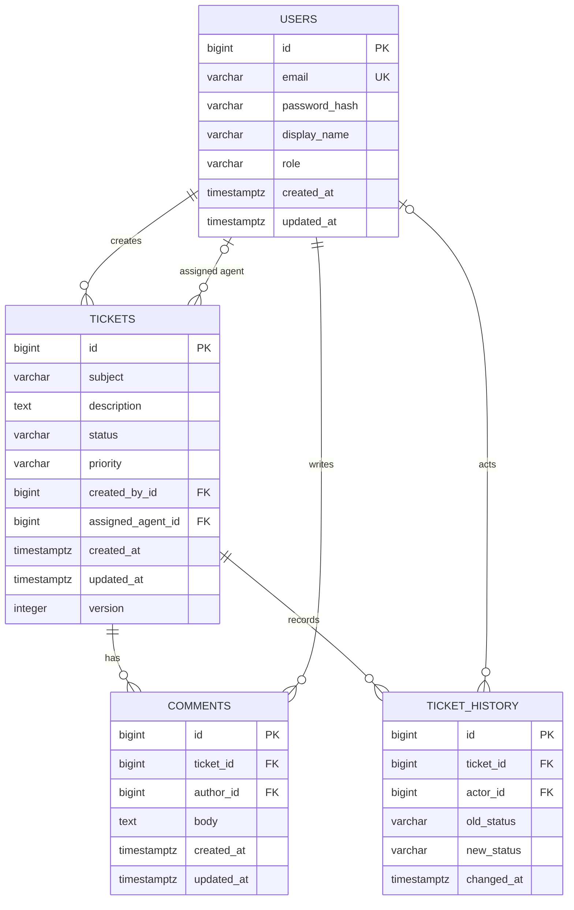

# Database Design

## Principles

Use PostgreSQL with normalized tables for accounts, tickets, comments, and ticket history. Use generated numeric identifiers initially for simple relational joins; UUIDs can be considered if public identifier opacity or distributed creation becomes a requirement. Store enums as readable strings rather than ordinal positions so adding/reordering enum constants cannot silently reinterpret existing rows.

All timestamps should be stored as `timestamptz` in UTC. The schema below is the initial logical design; exact SQL types and constraints will be implemented in Flyway during Phase 3.

## Tables

### `users`

| Column | Type (proposed) | Rules / purpose |
|---|---|---|
| `id` | `bigint` | Primary key, generated |
| `email` | `varchar(320)` | Required, unique; normalized to lowercase by application policy |
| `password_hash` | `varchar(255)` | Required; Java entity property is `password`; one-way password hash only |
| `display_name` | `varchar(120)` | Required; Java entity property is `name` |
| `role` | `varchar(20)` | Required; `USER`, `AGENT`, `ADMIN` |
| `created_at` | `timestamptz` | Required |
| `updated_at` | `timestamptz` | Required |

Account deactivation remains a planned lifecycle policy; the Phase 3 schema does not yet include an `active` column.

One account has one role in the initial model. A separate roles/permissions model would be unnecessary until users need multiple roles or configurable permissions.

### `tickets`

| Column | Type (proposed) | Rules / purpose |
|---|---|---|
| `id` | `bigint` | Primary key, generated |
| `subject` | `varchar(200)` | Required; Java entity property is `title` |
| `description` | `text` | Required |
| `status` | `varchar(30)` | Required; proposed values below |
| `priority` | `varchar(20)` | Required; `LOW`, `MEDIUM`, `HIGH`, `URGENT` |
| `created_by_id` | `bigint` | Required FK to `users.id`; immutable creator attribution |
| `assigned_agent_id` | `bigint` | Nullable FK to `users.id`; assignment may be pending |
| `created_at` | `timestamptz` | Required |
| `updated_at` | `timestamptz` | Required |
| `version` | `integer` | Required; optimistic locking candidate |

Soft deletion remains a planned lifecycle policy; the Phase 3 schema does not yet include `deleted_at`.

Implemented initial statuses: `OPEN`, `IN_PROGRESS`, `RESOLVED`, `CLOSED`. `OPEN` is the expected creation default when ticket creation is implemented. The earlier proposal included `WAITING_ON_CUSTOMER`; it is excluded from this phase's enum and schema until the workflow requires it. Transition rules should be explicit in the service layer; this design does not imply every transition is valid.

### `comments`

| Column | Type (proposed) | Rules / purpose |
|---|---|---|
| `id` | `bigint` | Primary key, generated |
| `ticket_id` | `bigint` | Required FK to `tickets.id` |
| `author_id` | `bigint` | Required FK to `users.id` |
| `body` | `text` | Required; Java entity property is `message`; application should impose a maximum length |
| `created_at` | `timestamptz` | Required |
| `updated_at` | `timestamptz` | Required; set by entity lifecycle callback |

Comments are proposed as public conversation entries visible to ticket participants. Internal agent notes are excluded until explicitly agreed; adding a visibility flag later requires careful authorization on every read path.

### `ticket_history`

| Column | Type (proposed) | Rules / purpose |
|---|---|---|
| `id` | `bigint` | Primary key, generated |
| `ticket_id` | `bigint` | Required FK to `tickets.id` |
| `actor_id` | `bigint` | Nullable FK to `users.id`; nullable allows system-generated events and retained records if account policy evolves |
| `event_type` | `varchar(30)` | Required; `TICKET_CREATED`, `STATUS_CHANGED`, `ASSIGNED`, `UNASSIGNED`, or `REASSIGNED` |
| `old_status` | `varchar(30)` | Nullable; prior enum value |
| `new_status` | `varchar(30)` | Nullable for assignment-only events; resulting enum value otherwise |
| `old_assignee_id` | `bigint` | Nullable FK to `users.id`; previous agent for assignment changes |
| `new_assignee_id` | `bigint` | Nullable FK to `users.id`; resulting agent, including initial assignment |
| `changed_at` | `timestamptz` | Required; event time |

Phase 6 adds `event_type`, nullable `new_status`, and nullable `old_assignee_id`/`new_assignee_id` columns in Flyway V3. History records ticket creation, status transitions, and assignment/unassignment/reassignment. Rows are append-only through the public API. Existing V2 rows migrate as `STATUS_CHANGED` events.

## Relationships and cardinality

- `users (1) -> (many) tickets` through `tickets.created_by_id`: each ticket has exactly one creator; a user can create many tickets.
- `users (1) -> (zero or many) tickets` through `tickets.assigned_agent_id`: an agent can have many assigned tickets; a ticket may be unassigned. Application logic must verify the referenced account has role `AGENT`, because a basic FK cannot enforce role membership. Active-account enforcement will be added with the account lifecycle field/policy.
- `tickets (1) -> (many) comments`: each comment belongs to one ticket; deleting should be restricted/soft to preserve the conversation.
- `users (1) -> (many) comments` through `comments.author_id`: each comment has one author; account deactivation preserves attribution.
- `tickets (1) -> (many) ticket_history`: each history event belongs to one ticket.
- `users (1) -> (zero or many) ticket_history` through `actor_id`: a user may cause many events; system events can have no actor.

Foreign keys should use restrictive deletion behavior for users and tickets. The application should deactivate users and soft-delete tickets, so normal operations do not physically cascade away audit data.

## Indexes and constraints

- Unique constraint and case-insensitive unique index on `users.email`; the `User` constructor normalizes addresses to lowercase and trims whitespace.
- Index `tickets(created_by_id, created_at DESC)` for a user's ticket list.
- Index `tickets(assigned_agent_id, status, updated_at DESC)` for the agent work queue.
- Index `tickets(status, priority, created_at DESC)` for admin filtering and queue sorting.
- Index `comments(ticket_id, created_at)` for ticket conversation order.
- Index `ticket_history(ticket_id, changed_at)` for chronological audit retrieval; history IDs break timestamp ties in the response order. `ticket_history(event_type)` supports event filtering.
- Add checks for allowed enum strings if using string columns, plus required and length constraints where appropriate.
- Keep foreign keys indexed where PostgreSQL query patterns and delete/update checks require them; validate with real query patterns during implementation.

## ER diagram

## Decisions to confirm before implementation

1. Should admins be able to change a ticket's creator/owner, or is ownership immutable after creation?
2. Should ticket deletion mean soft deletion (recommended) and which role may perform it? Soft deletion is not part of the Phase 3 entity schema yet.
3. Are comments always public, or do agents need private internal notes?
4. Should a user registration endpoint permit only `USER`; how are initial admins and agents provisioned?
5. The initial allowed status transitions are agreed and documented in `ticket-workflow.md`; CLOSED is terminal. Should `WAITING_ON_CUSTOMER` be considered in a future version?
6. Is email verification or password reset required for the first release?
7. Are numeric IDs acceptable in API URLs, or should public ticket identifiers be opaque UUIDs?
