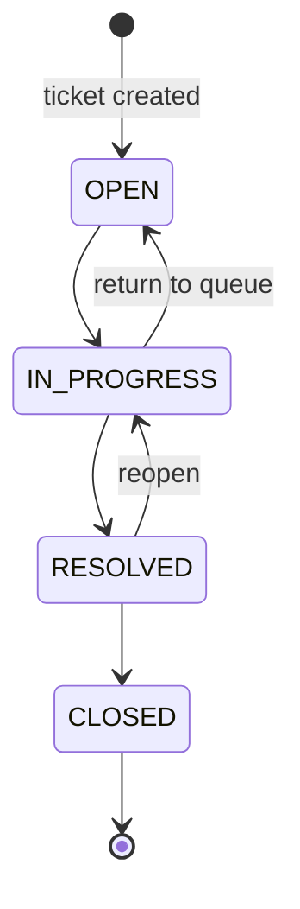

# Ticket Workflow and Business Rules

## Lifecycle

New tickets start in `OPEN`; priority defaults to `MEDIUM`. The creator is taken from the authenticated account. A ticket may remain unassigned until an administrator selects an agent.

Allowed status transitions are:

`CLOSED` is terminal. Submitting the current status is an idempotent no-op: it does not update the timestamp or create another history row. Other transitions outside the list fail with `400 Bad Request`.

## Assignment

Only `ADMIN` may call `PATCH /api/v1/tickets/{ticketId}/assign`. The service verifies that the ticket and target user exist and that a non-null target has role `AGENT`. An assignment may be changed to another agent or cleared with `{"agentId":null}`. The `agentId` property must be present in the request. Each actual change updates `updatedAt`; assigning the current agent again is a no-op.

Assignment has no automatic status side effect. After an administrator changes the assignment, the new agent may access the ticket. A demoted account may remain assigned; the API then prevents the account from acting as an agent. Reassignment policy can be reviewed with account deactivation in a later phase.

## Role permissions

- `USER` creates tickets and can read/comment/view history only for tickets they created. They cannot change status, priority, or assignment.
- `AGENT` reads and comments on tickets assigned to them, and may change status for those tickets. Agents cannot assign tickets or change priority/details.
- `ADMIN` reads and manages any ticket, changes priority/status, assigns/reassigns/unassigns agents, and manages users.

All resource ownership is checked in services using the account loaded from Spring Security's context. Client-supplied creator/author/actor identities are not accepted.

## Priority and ticket details

Priorities are `LOW`, `MEDIUM`, `HIGH`, and `URGENT`. Administrators may change priority and ticket details through `PUT /api/v1/tickets/{id}`. Updates preserve omitted fields. Creator identity is immutable through the API.

## Comments

Ticket creators, the currently assigned agent, and administrators may add comments. The author is always the authenticated account. Messages must contain non-whitespace text and be at most 5000 characters. Comments are public to authorized ticket participants; there is no internal-note mode. Comments are not editable or deletable through the API.

## Audit history

History is append-only through public endpoints. Ticket creation records `TICKET_CREATED` with `oldStatus: null` and `newStatus: OPEN`. Every actual allowed status change records its actor, prior status, resulting status, and time. Assignment, reassignment, and unassignment are also recorded with before/after agents because the requirements call for ownership changes to be auditable. A repeated same-status or same-agent request creates no duplicate event.

Ticket mutation and its audit insert share one transaction, so neither is committed without the other. History reads follow the same owner/assignee/admin visibility checks as ticket reads.

## Admin user management

Only administrators can list users, view any user, or update roles through `/api/v1/admin/users`. Role updates are limited to `USER` and `AGENT`; this endpoint cannot create another administrator. A sole administrator cannot demote their own account. Password hashes are never included in user responses.
